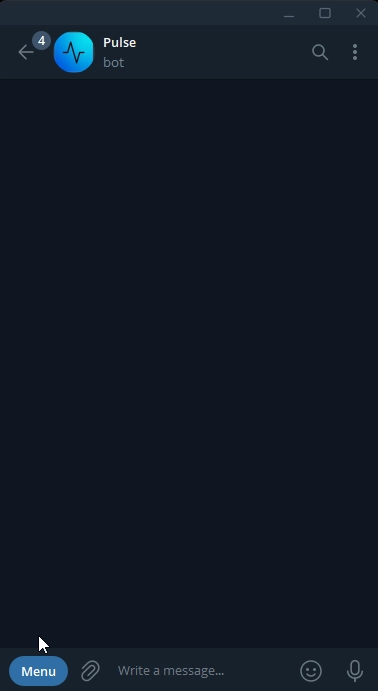
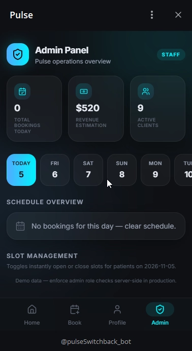
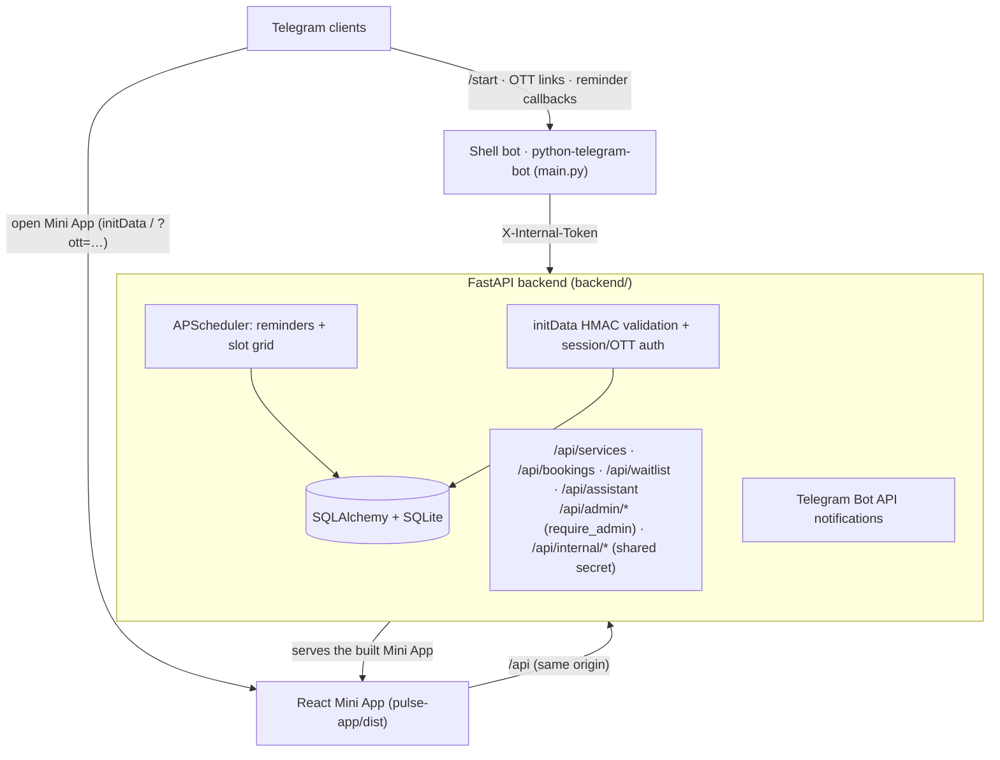

# Pulse — Clinic Booking Telegram Mini App

[](.github/workflows/ci.yml)

A full-stack appointment-booking system for a clinic, delivered as a **Telegram
Mini App** with a Telegram shell bot, a FastAPI backend, and a React frontend.

**Patients** book services in two taps (or by asking the built-in assistant in
plain English), get Telegram reminders with Confirm/Reschedule buttons, and can
join a waitlist for fully booked days. **The clinic** manages the catalog,
working hours, holidays, and per-slot availability from an admin panel, and
watches revenue/analytics.

| Area | Details |
|---|---|
| Backend | Python 3.12, FastAPI, SQLAlchemy 2, SQLite (swap via `PULSE_DB_URL`), APScheduler |
| Frontend | React 18, Vite, Tailwind, TanStack Query, Telegram WebApp SDK |
| Bot | python-telegram-bot (shell: launch button, login tokens, reminder callbacks) |
| Tests | 51 backend (pytest, in-memory DB), frontend unit (Vitest) + E2E (Playwright) |
| CI | GitHub Actions: ruff + pytest, eslint + vitest + build, Playwright E2E |

## Demo

Recorded live in Telegram. Try it yourself in one command:

```bash
docker compose up --build   # → http://localhost:8000 (browser demo mode)
```

| Booking flow (patient) | Admin panel (clinic) |
|---|---|
|  |  |

---

## Features

**Patient (Mini App)**
- Service catalog with prices, durations, and public reviews (names anonymized)
- 14-day booking wizard with live slot availability and conflict handling (409s surfaced in UI)
- Reschedule and cancel, "add to calendar" (ICS), countdown to the visit
- Rule-based assistant: *"find a massage slot tomorrow morning"* → tap-to-book suggestions
- Waitlist: get pinged when a slot on your day opens up
- Post-visit star ratings
- Auth: Telegram `initData` HMAC validation, plus a bot-issued one-time-token
  login that survives lost launch params (`?ott=…` deep link)

**Clinic (Admin panel inside the Mini App)**
- Overview metrics (bookings today, estimated revenue, active clients, avg rating)
- 7-day analytics: bookings per day, top services
- Services CRUD with QR codes (deep links) and CSV export (formula-injection safe)
- Working-hours rules per weekday + holidays → slot grid rebuilt automatically
- Manual slot on/off toggles (occupied slots are protected)
- Waitlist overview, review moderation view

**Infrastructure**
- Duration-aware slot claiming: a booking holds every 30-minute grid slot its service spans (`[start, start+duration)`), so two patients can never overlap — enforced by one atomic conditional `UPDATE` + a partial unique index, with commit-failure rollback
- `/api/slots?service_id=…` is duration-aware: only starts whose whole appointment fits are listed
- Reminders 24h/2h before the visit (at-most-once flags), with Confirm attendance callback
- Hourly job rolls the bookable slot window forward
- Sliding-window rate limiting (XFF-aware) on booking/assistant endpoints
- Replay-protected initData (24h `auth_date` window, configurable)
- Fail-closed auth: anonymous access is opt-in and never grants admin
- Security headers (CSP `frame-ancestors` for Telegram, nosniff, referrer policy)
- Secrets never logged (bot-token URLs masked in exception handlers)

---

## Architecture



## Quickstart

### Option A — Docker (one command)

```bash
docker compose up --build
```

Open http://localhost:8000 — the Mini App and API run on one origin with demo
data. A fresh database ships with demo bookings and reviews (the admin panel
looks alive immediately); delete `backend/pulse.db` (or the Docker volume) to
reset, and disable with `PULSE_SEED_DEMO_DATA=false`. Bookings persist in a
Docker volume.

### Option B — Frontend demo (no backend)

```bash
cd pulse-app
npm install
npm run dev
```

Open http://localhost:5173 — the whole UI (booking, assistant, waitlist,
admin) runs on in-memory mock data. `VITE_API_BASE_URL` must be empty.

### Option C — Full local stack (Windows)

```cmd
:: 1. API
cd backend
py -3 -m venv .venv
.venv\Scripts\pip install -r requirements.txt
.venv\Scripts\python -m uvicorn main:app --reload --port 8000

:: 2. Frontend (proxies /api -> localhost:8000)
cd ..\pulse-app
npm install
npm run dev

:: 3. Telegram shell bot (optional; needs MINI_APP_URL + tokens in .env)
cd ..
py -3 main.py
```

For real Telegram testing the Mini App must be reachable over public HTTPS —
expose it with `ngrok http 8000` and set `MINI_APP_URL` in `.env` to the
tunnel URL.

## Testing

```bash
# backend
cd backend
python -m ruff check app tests main.py
python -m pytest -q

# frontend
cd pulse-app
npm run lint && npm run test && npm run build
npm run test:e2e        # Playwright (demo mode)
```

## Security model

| Concern | Approach |
|---|---|
| Identity | Telegram `initData` HMAC-SHA256 (per Bot API docs) + `auth_date` freshness window (24h, `PULSE_INITDATA_MAX_AGE`) |
| Long sessions | Bot-issued one-time tokens exchanged for a 7-day session (`/api/auth/ott`) |
| Admin access | Server-side allowlist `PULSE_ADMIN_IDS`; the UI shows the admin tab from `GET /api/me`, never from build env |
| Anonymous mode | Opt-in via `PULSE_ALLOW_ANONYMOUS=true`, ordinary users only; `PULSE_DEV_ADMIN` is a local-dev-only admin shortcut |
| Booking races | Duration-range claims: one conditional `UPDATE` over the appointment's slot span + partial unique index on active bookings; commit failures roll back the claim and surface 409 |
| Input | Pydantic schemas, regex-validated dates/times, parameterized SQLAlchemy queries |
| Abuse | Per-client sliding-window rate limits (XFF-aware), Telegram sends fail soft |
| Data exposure | Public reviews show first name + initial; CSV export escapes formula prefixes (`=+-@`); secrets masked in logs |

**Known trade-offs (honest list):** sessions live in process memory (restart
logs everyone out; a Redis store is the next step), rate limiting is
single-worker, SQLite is fine for a demo but the schema is Postgres-ready via
`PULSE_DB_URL`.

## Environment variables

See [.env.example](.env.example) (shell bot) and [backend/.env.example](backend/.env.example)
(API) — every variable is documented there. Frontend: `VITE_API_BASE_URL`
(`/api` for live mode, empty for the mock demo).

## Project structure

```
├── main.py                # Telegram shell bot (launch button, OTT, callbacks)
├── handlers/  config.py  messages.py
├── backend/
│   ├── main.py            # FastAPI app, scheduler, static Mini App hosting
│   └── app/
│       ├── routers/       # services, bookings, waitlist, admin, internal…
│       ├── auth.py        # OTT + in-memory sessions
│       ├── telegram.py    # initData HMAC validation
│       ├── schedule.py    # working-hours → slot grid engine
│       ├── reminders.py   # 24h/2h reminder job
│       └── assistant.py   # rule-based booking assistant
└── pulse-app/             # React Mini App (screens, admin, mock demo mode)
```

## Troubleshooting (Windows)

- `python` is the Store stub — use `py -3`.
- After changing `.env`, restart `npm run dev` / the backend.
- The browser demo logs you in as a demo user; real identity requires Telegram.
- Patients must press **Start** on the bot before it can DM them reminders.

## License

[MIT](LICENSE)
