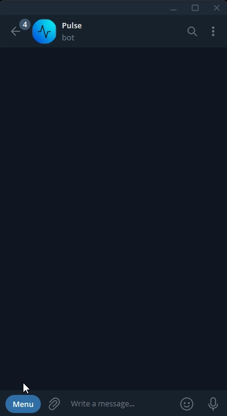
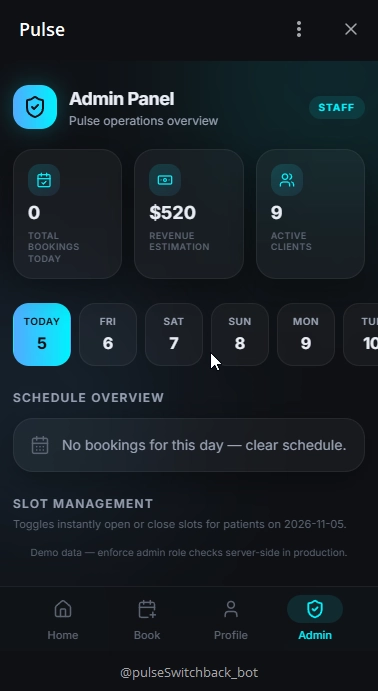
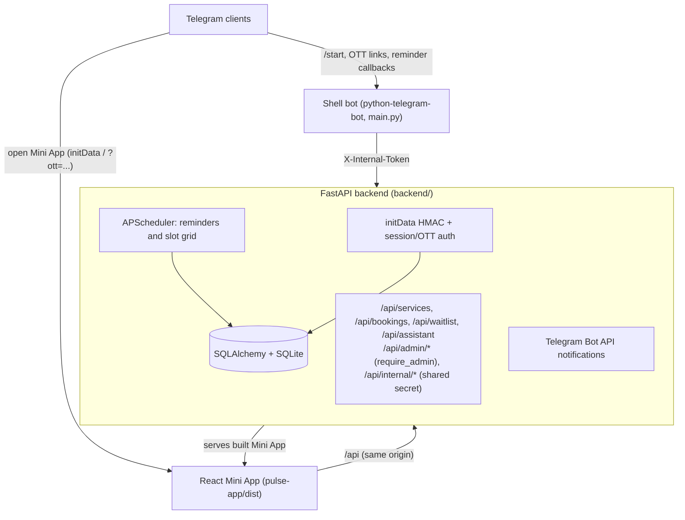

# Pulse

[](.github/workflows/ci.yml)

Clinic appointment booking system delivered as a Telegram Mini App, backed by FastAPI, React, and a Telegram bot shell.

Patients can browse services, book appointments directly or through a rule-based assistant, receive Telegram reminders with confirm/reschedule actions, and join a waitlist for full days. Clinic staff manage the service catalog, working hours, holidays, slot availability, and basic analytics from an in-app admin panel.

| Component | Stack |
|---|---|
| Backend | Python 3.12, FastAPI, SQLAlchemy 2, SQLite (configurable via `PULSE_DB_URL`), APScheduler |
| Frontend | React 18, Vite, Tailwind CSS, TanStack Query, Telegram WebApp SDK |
| Bot | `python-telegram-bot` (launch button, login tokens, reminder callbacks) |
| Tests | 51 backend tests (pytest, in-memory DB), Vitest (frontend unit), Playwright (E2E) |
| CI | GitHub Actions: `ruff`, `pytest`, `eslint`, `vitest`, production build, Playwright E2E |

## Demo

| Patient booking flow | Clinic admin panel |
|---|---|
|  |  |

To run the browser demo locally:

```bash
docker compose up --build
```

Then open `http://localhost:8000`.

## Features

### Patient (Mini App)
- Service catalog with pricing, duration, and anonymized public reviews
- 14-day booking flow with live slot availability and conflict handling (HTTP 409 surfaced in the UI)
- Rescheduling, cancellation, ICS calendar export, and visit countdown
- Rule-based booking assistant (e.g., *"find a massage slot tomorrow morning"*) returning directly bookable slots
- Waitlist notifications when a slot opens on a selected day
- Post-visit star ratings
- Authentication via Telegram `initData` HMAC validation, plus bot-issued one-time token (`?ott=...`) deep links for cases where launch parameters are lost

### Clinic (Admin Panel)
- Summary metrics: bookings today, estimated revenue, active clients, average rating
- 7-day analytics: daily booking volume and top services
- Service CRUD with deep-link QR codes and CSV export (escaped against formula injection)
- Weekday schedule rules and holiday overrides that automatically rebuild the slot grid
- Manual per-slot enable/disable toggles (occupied slots cannot be disabled)
- Waitlist overview and review moderation

### Backend & Infrastructure
- Duration-aware slot locking: a booking claims every 30-minute grid slot covered by `[start, start + duration)`, enforced via an atomic conditional `UPDATE` and a partial unique index with rollback on commit failure
- Duration-aware availability (`GET /api/slots?service_id=...`), returning only start times that fit the full service duration
- Automated 24h and 2h visit reminders (at-most-once delivery flags) with attendance confirmation callbacks
- Hourly background job extending the bookable slot window
- Sliding-window rate limiting (`X-Forwarded-For`-aware) on booking and assistant endpoints
- Replay protection on `initData` (configurable 24h `auth_date` window)
- Fail-closed authentication: anonymous mode is opt-in and never grants admin permissions
- Security headers (CSP `frame-ancestors` for Telegram, `X-Content-Type-Options: nosniff`, referrer policy)
- Secret redaction in logs (bot token URLs masked in exception handlers)

## Architecture



## Quickstart

### Docker

```bash
docker compose up --build
```

Open `http://localhost:8000`. The API and built Mini App are served from the same origin, with bookings persisted in a Docker volume.

A fresh database seeds sample bookings and reviews by default. Delete `backend/pulse.db` (or the Docker volume) to reset, or set `PULSE_SEED_DEMO_DATA=false` to start with an empty database.

### Frontend Only (Mock Mode)

```bash
cd pulse-app
npm install
npm run dev
```

Open `http://localhost:5173`. With `VITE_API_BASE_URL` left empty, the UI (booking, assistant, waitlist, and admin panel) runs against in-memory mock data.

### Local Development (Windows)

```cmd
:: 1. API
cd backend
py -3 -m venv .venv
.venv\Scripts\pip install -r requirements.txt
.venv\Scripts\python -m uvicorn main:app --reload --port 8000

:: 2. Frontend (proxies /api to localhost:8000)
cd ..\pulse-app
npm install
npm run dev

:: 3. Telegram shell bot (optional; requires MINI_APP_URL and tokens in .env)
cd ..
py -3 main.py
```

Testing inside Telegram requires a public HTTPS endpoint. Expose port 8000 (for example, `ngrok http 8000`) and set `MINI_APP_URL` in `.env` to the tunnel URL.

## Testing

```bash
# Backend
cd backend
python -m ruff check app tests main.py
python -m pytest -q

# Frontend
cd pulse-app
npm run lint && npm run test && npm run build
npm run test:e2e      # Playwright (demo mode)
```

## Security Model

| Area | Implementation |
|---|---|
| Identity | Telegram `initData` HMAC-SHA256 verification (per Bot API spec) with a 24h `auth_date` freshness window (`PULSE_INITDATA_MAX_AGE`) |
| Sessions | Bot-issued one-time tokens exchanged for 7-day sessions via `/api/auth/ott` |
| Admin access | Server-side allowlist via `PULSE_ADMIN_IDS`; admin UI visibility comes from `GET /api/me`, not build-time flags |
| Anonymous access | Opt-in via `PULSE_ALLOW_ANONYMOUS=true` (regular users only); `PULSE_DEV_ADMIN` is restricted to local development |
| Booking concurrency | Conditional `UPDATE` across the full duration span plus a partial unique index on active bookings; failed commits roll back and return HTTP 409 |
| Input validation | Pydantic schemas, regex-checked date/time fields, parameterized SQLAlchemy queries |
| Rate limiting | Per-client sliding-window limits (`X-Forwarded-For`-aware); Telegram API delivery fails soft |
| Data handling | Public reviews display first name and last initial only; CSV export escapes formula prefixes (`=`, `+`, `-`, `@`); secrets are masked in logs |

**Known limitations:**
- Sessions are stored in process memory, so a server restart logs users out (a Redis store is the logical next step).
- Rate limiting is scoped to a single worker process.
- SQLite is used by default for local setup; the schema is compatible with PostgreSQL via `PULSE_DB_URL`.

## Configuration

All environment variables are documented in [.env.example](.env.example) (bot) and [backend/.env.example](backend/.env.example) (API). For the frontend, set `VITE_API_BASE_URL` to `/api` for live mode or leave it empty for mock demo mode.

## Project Structure

```text
├── main.py               # Telegram shell bot (launch button, OTT, callbacks)
├── config.py             # Bot configuration
├── messages.py           # Bot message templates
├── handlers/             # Telegram command and callback handlers
├── backend/
│   ├── main.py           # FastAPI entrypoint, scheduler, static Mini App hosting
│   └── app/
│       ├── routers/      # services, bookings, waitlist, admin, internal
│       ├── auth.py       # OTT exchange and in-memory sessions
│       ├── telegram.py   # initData HMAC validation
│       ├── schedule.py   # Working hours and slot grid generation
│       ├── reminders.py  # 24h/2h reminder job
│       └── assistant.py  # Rule-based booking assistant
└── pulse-app/            # React Mini App (patient flows, admin panel, mock mode)
```

## Troubleshooting (Windows)

- If `python` opens the Microsoft Store stub, use `py -3` instead.
- Restart both `npm run dev` and the backend after editing `.env`.
- Browser demo mode signs in as a demo user; testing real Telegram authentication requires opening the app inside Telegram.
- Users must press **Start** in the bot chat before it can send direct reminder messages.

## License

[MIT](LICENSE)
